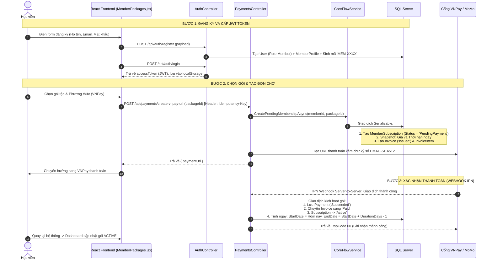
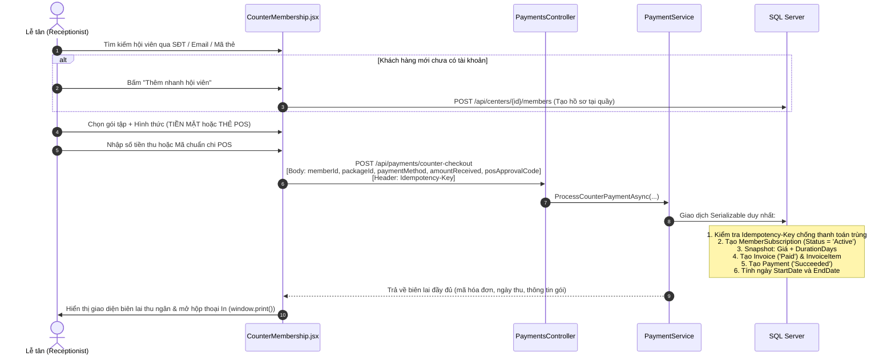
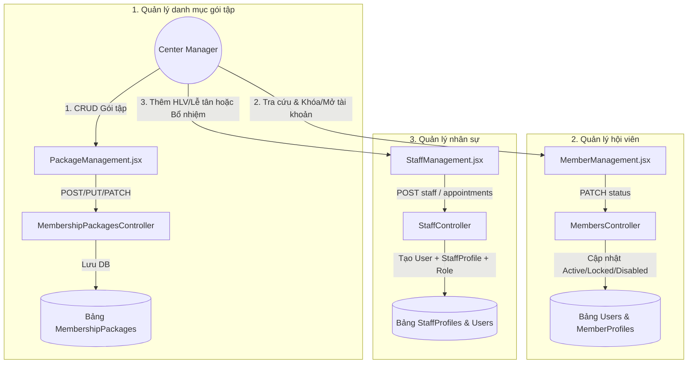

# TÀI LIỆU KỸ THUẬT TOÀN DIỆN: FLOW 1 — USER AND MEMBERSHIP MANAGEMENT
## (Lý thuyết công nghệ, kiến trúc hệ thống & chi tiết luồng vận hành từ Frontend đến Backend)

---

## 1. TỔNG QUAN VÀ PHẠM VI NGHIỆP VỤ (BUSINESS SCOPE)

Flow 1 là phân hệ nghiệp vụ cốt lõi của hệ thống **Sports Center Management System (SCMS)**, chịu trách nhiệm thiết lập dữ liệu nền tảng cho toàn bộ hoạt động của trung tâm thể thao:
1. **Xác thực & Danh tính (Authentication & Identity):** Đăng ký tài khoản, đăng nhập mật khẩu / Google Identity (OAuth 2.0 / OIDC), cấp phát và kiểm chứng JWT Bearer token, chính sách bảo vệ mật khẩu và khóa tài khoản chống brute-force.
2. **Phân quyền người dùng (Authorization & RBAC):** Kiểm soát quyền hạn theo vai trò (`Admin`, `Manager`, `Coach`, `Receptionist`, `Member`), phân định phạm vi cơ sở trung tâm (`Center Scope`) và kiểm soát năng lực thao tác (`Center Capability`).
3. **Quản lý hồ sơ người dùng (User Profiles & Staff):** Tự động sinh mã hội viên (`MemberCode`), quản lý hồ sơ `MemberProfile`, quản lý nhân sự `StaffProfile` (Huấn luyện viên, Lễ tân, Quản lý) và quy trình thuyên chuyển/bổ nhiệm.
4. **Quản lý danh mục gói tập (Membership Packages):** Định nghĩa gói tập (tên gói, giá niêm yết, thời hạn ngày, số môn được tập, số buổi tối đa, tính năng đi kèm, bật/tắt mở bán).
5. **Quy trình mua & Kích hoạt gói tập (Subscription & Invoicing Lifecycle):**
   * **Mua trực tuyến (Online Self-Service):** Hội viên tự đặt mua $\rightarrow$ khởi tạo gói chờ (`PendingPayment`) $\rightarrow$ tạo hóa đơn (`Invoice`) $\rightarrow$ thanh toán qua cổng số (VNPay / MoMo / VietQR PayOS) $\rightarrow$ Webhook IPN tự động kích hoạt gói `Active`.
   * **Mua tại quầy (Counter Service):** Lễ tân tra cứu hoặc tạo nhanh hồ sơ $\rightarrow$ chọn gói $\rightarrow$ thu tiền mặt (`CASH`) hoặc quẹt thẻ (`POS`) $\rightarrow$ kích hoạt tức thì trong 1 giao dịch và in biên lai.
6. **Quy tắc thời gian hiệu lực (Effective Date Policy):**
   * **Gói mua mới:** Bắt đầu tính từ ngày thanh toán đủ. Ngày kết thúc trọn ngày (inclusive): `EndDate = StartDate + DurationDays - 1`.
   * **Gói gia hạn:** Nếu hội viên đang có một gói còn hiệu lực, gói mới bắt đầu nối tiếp vào ngày kế tiếp ngày hết hạn của gói hiện tại (`StartDate = EndDate_cũ + 1`).

---

## 2. NỀN TẢNG LÝ THUYẾT VÀ CÁC CÔNG NGHỆ ÁP DỤNG

### 2.1. Nền tảng Frontend (Client-side)
* **React 18 (Single Page Application - SPA):**
  * **Declarative UI & Virtual DOM:** Giao diện phản hồi trạng thái dữ liệu tức thì, tối ưu hóa quá trình re-render khi thay đổi form hoặc chuyển bước thanh toán.
  * **React Hooks:** Sử dụng triệt để `useState` (quản lý trạng thái form, modal, dữ liệu tải), `useEffect` (đồng bộ dữ liệu từ server khi mount), `useCallback` / `useMemo` (tránh khởi tạo lại hàm/dữ liệu tính toán không cần thiết).
  * **Custom Hooks & Context API:**
    * `AuthContext` (`useAuth`): Cung cấp trạng thái đăng nhập cho giao diện. JWT do backend cấp được giữ trong bộ nhớ của từng tab qua `http.js`; hồ sơ và quyền lấy từ API được xác thực bằng JWT rồi giữ trong `authState.js`. Không lưu Session/token/hồ sơ vào browser storage hoặc cookie. F5 hoặc mở tab mới cần đăng nhập lại; logout và HTTP 401 chỉ ảnh hưởng tab tương ứng.
    * `ToastContext` (`useToast`): Hiển thị thông báo trạng thái thao tác UI (thành công, cảnh báo, lỗi) theo thời gian thực.
* **Vite (Frontend Tooling):**
  * Máy chủ phát triển nội bộ chạy trên nền Native ECMAScript Modules (ESM) mang lại tốc độ Hot Module Replacement (HMR) cực nhanh.
  * Quản lý biến môi trường an toàn qua `import.meta.env` (ví dụ: `VITE_SPORTS_CENTER_ID`, `VITE_API_BASE_URL`).
* **Tailwind CSS & Utility-First Architecture:**
  * Xây dựng giao diện thể thao hiện đại, nhất quán về bảng màu (slate/red/emerald/amber), tỷ lệ hiển thị responsive (Desktop, Tablet, Mobile).
  * Hỗ trợ giao diện in ấn chuyên dụng (`@media print`) trong `CounterMembership.jsx` giúp ẩn thanh điều hướng, chỉ in đúng biên lai hóa đơn thu ngân.
* **Cơ chế HTTP Client & Interceptor (`http.js` / `backendApi.js`):**
  * Tự động đính kèm header `Authorization: Bearer <token>` cho mọi request cần xác thực.
  * Bắt lỗi tập trung (Global Error Handling): Tự động phát hiện lỗi `401 Unauthorized` để thu hồi token và điều hướng về trang đăng nhập.
  * Sinh mã khóa chống trùng lặp `Idempotency-Key` (dùng `crypto.randomUUID()`) cho các thao tác thanh toán tài chính.

### 2.2. Nền tảng Backend (.NET 10 / ASP.NET Core Web API)
* **RESTful API Principles:**
  * Sử dụng chuẩn ngữ nghĩa của HTTP: `GET` (đọc dữ liệu), `POST` (tạo mới), `PUT` (cập nhật toàn bộ), `PATCH` (cập nhật một phần), `DELETE` (xóa/hủy).
  * Phản hồi mã trạng thái HTTP chuẩn: `200 OK`, `201 Created`, `400 Bad Request`, `401 Unauthorized`, `403 Forbidden`, `404 Not Found`, `409 Conflict`.
* **Lập trình bất đồng bộ (Asynchronous Programming):**
  * 100% các thao tác I/O (Database, HTTP Gateway) sử dụng từ khóa `async / await` kèm theo `CancellationToken` để giải phóng luồng xử lý (Thread Pool threads), giúp hệ thống chịu tải cao (High Throughput).
* **Entity Framework Core 10 (ORM - Object Relational Mapping):**
  * **Code-First Approach:** Cấu trúc Database được định nghĩa hoàn toàn bằng C# Classes và Fluent API trong `SportsCenterDbContext`.
  * **Timestamped Migrations:** Quản lý lịch sử nâng cấp schema bằng các migration có tiền tố timestamp (`yyyyMMddHHmmss_<MigrationName>.cs`) đồng bộ chặt chẽ với bảng `__EFMigrationsHistory`.
  * **Change Tracker & Query Tracking:** Sử dụng `AsNoTracking()` cho các truy vấn chỉ đọc để tối ưu bộ nhớ RAM, và Change Tracker cho các thao tác cập nhật trạng thái.

### 2.3. Cơ sở dữ liệu quan hệ (Microsoft SQL Server)
* **Tính chất ACID:** Đảm bảo toàn vẹn tuyệt đối:
  * **Atomicity (Nguyên tử):** Mọi thao tác trong giao dịch tạo hóa đơn + thu tiền + kích hoạt gói phải cùng thành công hoặc cùng bị rollback.
  * **Consistency (Nhất quán):** Dữ liệu tuân thủ nghiêm ngặt các ràng buộc khóa ngoại (Foreign Keys), ràng buộc kiểm tra (Check Constraints), chỉ mục duy nhất (Unique Indexes).
  * **Isolation (Cô lập):** Kiểm soát tranh chấp dữ liệu khi nhiều tiến trình chạy song song thông qua cấp độ khóa `Serializable`.
  * **Durability (Bền vững):** Sau khi commit, dữ liệu được ghi xuống Transaction Log và đĩa cứng an toàn.
* **Tối ưu kiểu dữ liệu:**
  * Tiền tệ sử dụng `decimal(18,2)` để tránh sai số dấu phẩy động.
  * Thời gian chuẩn hóa theo chuẩn ISO 8601 UTC (`DateTime.UtcNow`).

---

## 3. KIẾN TRÚC PHẦN MỀM VÀ CÁC DESIGN PATTERNS ÁP DỤNG

### 3.1. Mô hình kiến trúc phân tầng (Layered / N-Tier Architecture)

```
┌────────────────────────────────────────────────────────────────────────┐
│ 1. PRESENTATION LAYER (SportsCenterManagement.API)                     │
│    - Controllers: Nhận HTTP Request, validate ModelState, gọi Service. │
│    - Action Filters: Phân quyền [RequirePermission], [CenterCapability]│
│    - DTOs / ViewModels: Định hình payload đầu vào/đầu ra qua mạng.    │
└───────────────────────────────────┬────────────────────────────────────┘
                                    │
┌───────────────────────────────────▼────────────────────────────────────┐
│ 2. BUSINESS LOGIC LAYER - BLL (SportsCenterManagement.BLL)             │
│    - Services: CoreFlowService, PaymentService, MemberService, ...     │
│    - Business Rules: Kiểm tra gói active, tính Start/End Date, khóa tk.│
│    - Domain Exceptions: BusinessException, ValidationException.        │
└───────────────────────────────────┬────────────────────────────────────┘
                                    │
┌───────────────────────────────────▼────────────────────────────────────┐
│ 3. DATA ACCESS LAYER - DAL (SportsCenterManagement.DAL)                │
│    - SportsCenterDbContext: Quản lý DbSets, cấu hình bảng, quan hệ.   │
│    - Repository & Unit of Work: Điều phối transaction và truy vấn DB.  │
│    - Migrations: Lịch sử tiến hóa schema cơ sở dữ liệu.                │
└───────────────────────────────────┬────────────────────────────────────┘
                                    │
┌───────────────────────────────────▼────────────────────────────────────┐
│ 4. DOMAIN ENTITIES LAYER (SportsCenterManagement.Models)               │
│    - User, Role, Center, MemberProfile, StaffProfile                   │
│    - MembershipPackage, MemberSubscription, Invoice, Payment, AuditLog │
└────────────────────────────────────────────────────────────────────────┘
```

### 3.2. Các Design Patterns cốt lõi trong Flow 1
1. **Repository Pattern & Unit of Work (UoW):**
   * `IUnitOfWork` đóng gói `SportsCenterDbContext`. Cho phép gom nhiều thao tác thêm `Invoice`, cập nhật `MemberSubscription`, thêm `Payment` vào trong một đơn vị công việc duy nhất trước khi gọi `SaveChangesAsync()`.
2. **Dependency Injection (DI) & Inversion of Control (IoC):**
   * Sử dụng container có sẵn của ASP.NET Core (`IServiceCollection`).
   * Đăng ký dịch vụ với vòng đời `AddScoped`: mỗi HTTP Request tạo một instance riêng của `SportsCenterDbContext`, `IMemberService`, `ICoreFlowService`, `IPaymentService` và tự động giải phóng khi request kết thúc.
3. **Data Transfer Object (DTO) Pattern:**
   * Tách rời hoàn toàn Entity của Database và dữ liệu nhận/trả qua API.
   * Ngăn chặn lỗi bảo mật **Over-posting / Mass Assignment** (ví dụ: ngăn người dùng tự gửi trường `RoleId = Admin` khi gọi API đăng ký).
   * Che giấu các trường nhạy cảm như `PasswordHash`, `SecurityStamp`.
4. **Idempotency Pattern (Khóa chống trùng lặp):**
   * Áp dụng header `Idempotency-Key` kết hợp cùng `UserId` tạo thành `ScopedKey`.
   * Khi thanh toán hoặc tạo đơn, hệ thống kiểm tra nếu `ScopedKey` đã tồn tại thì trả về ngay kết quả giao dịch cũ, không thực hiện trừ tiền hoặc sinh hóa đơn lần 2.
5. **Snapshot Pattern (Lưu ảnh chụp trạng thái):**
   * Trong thực tế, giá và thời hạn của một gói tập (`MembershipPackage`) có thể được người quản lý điều chỉnh tăng/giảm theo thời gian.
   * Khi mua gói, giá trị `Price` và `DurationDays` tại thời điểm đó được copy trực tiếp vào bản ghi `MemberSubscription` và `InvoiceItem`. Điều này bảo đảm rằng mọi sự thay đổi trong tương lai của gói gốc không làm sai lệch hợp đồng đã ký kết của hội viên.

---

## 4. LÝ THUYẾT BẢO MẬT, XÁC THỰC VÀ PHÂN QUYỀN

### 4.1. Cơ chế JWT (JSON Web Token) & Bearer Token
JWT là một chuỗi ký tự chuẩn hóa (RFC 7519) bao gồm 3 phần phân tách bởi dấu chấm:
$$\text{Header}.\text{Payload}.\text{Signature}$$
* **Header:** Chứa thuật toán mã hóa (ví dụ: `HMAC-SHA256`).
* **Payload:** Chứa các **Claims** (tuyên bố danh tính):
  * `sub` / `NameIdentifier`: ID duy nhất của người dùng (`UserId`).
  * `email`: Địa chỉ email.
  * `role`: Vai trò của tài khoản (`ADMIN`, `MANAGER`, `COACH`, `RECEPTIONIST`, `MEMBER`).
  * `exp`: Thời điểm token hết hạn (trong hệ thống là 1 giờ).
* **Signature:** Được ký bằng khóa bí mật phía Server (`SymmetricSecurityKey`). Phía server giải mã và kiểm tra tính toàn vẹn mà không cần truy vấn bảng session, giúp ứng dụng đạt kiến trúc **Stateless Authentication**.

### 4.2. Phân quyền RBAC & Kiểm soát theo cơ sở (Center Scope & Capabilities)
* **RBAC (Role-Based Access Control):** Kiểm soát dựa trên vai trò qua thuộc tính `[Authorize(Roles = "...")]`.
* **Center Capability Authorization:**
  * Mỗi trung tâm thể thao có thể cấu hình ma trận năng lực riêng biệt (`[CenterCapability("register_counter_package")]`).
* **Ngăn chặn lỗi BOLA / IDOR (Broken Object Level Authorization):**
  * Trong môi trường nhiều chi nhánh (Multi-center), một Lễ tân tại Trung tâm A không được phép tra cứu hoặc bán gói cho hội viên bị gán cố định ở Trung tâm B.
  * Backend luôn so sánh: `staffCenterId == package.CenterId` trước khi thực hiện giao dịch.

### 4.3. An toàn mật khẩu & Chống tấn công dò mật khẩu (Brute-Force)
* **Băm mật khẩu (Password Hashing):** Mật khẩu người dùng được băm với muối ngẫu nhiên (Salt) thông qua thuật toán PBKDF2 của ASP.NET Core Identity. Mật khẩu gốc không bao giờ được lưu trữ dạng bản rõ (plaintext).
* **Chính sách mật khẩu (Password Policy):** Bắt buộc tối thiểu 6 ký tự, gồm chữ hoa, chữ thường, số và ký tự đặc biệt.
* **Cơ chế khóa tài khoản (Account Lockout):** Sau 5 lần đăng nhập thất bại liên tiếp, tài khoản tự động bị khóa trong 15 phút (`LockedUntil = DateTime.UtcNow.AddMinutes(15)`), triệt tiêu nguy cơ tấn công từ điển / brute-force.

### 4.4. Đăng nhập qua bên thứ ba (Google Identity Services)
* Frontend tích hợp thư viện Google Sign-In SDK để lấy về **Google ID Token (JWT do Google ký)**.
* Frontend gửi ID Token này lên endpoint `POST /api/auth/google`.
* Backend sử dụng thư viện `GoogleJsonWebSignature.ValidateAsync` để giải mã, xác thực chữ ký trực tiếp với máy chủ Google, kiểm tra `email_verified == true`, sau đó tự động tạo hoặc liên kết tài khoản trong hệ thống.

---

## 5. LÝ THUYẾT QUẢN LÝ GIAO DỊCH & XỬ LÝ ĐỒNG THỜI (CONCURRENCY)

### 5.1. Tại sao cần `IsolationLevel.Serializable` trong Flow 1?
Trong các hệ thống bán vé, phòng tập hoặc tài chính, lỗi kinh điển thường gặp là **Race Condition** (2 request nhấn cùng một tích tắc dẫn tới việc sinh ra 2 hóa đơn cho cùng 1 người, hoặc trừ tiền 2 lần).

| Cấp độ cách ly (Isolation Level) | Đọc dữ liệu rác (Dirty Read) | Đọc không lặp lại (Non-repeatable Read) | Đọc bóng ma (Phantom Read) |
| :--- | :---: | :---: | :---: |
| Read Uncommitted | Có thể bị | Có thể bị | Có thể bị |
| Read Committed (Mặc định) | **Không** | Có thể bị | Có thể bị |
| Repeatable Read | **Không** | **Không** | Có thể bị |
| **Serializable (Được dùng trong Flow 1)** | **Không** | **Không** | **Không** |

* Trong `CoreFlowService.CreatePendingMembershipAsync` và `PaymentService.ProcessCounterPaymentAsync`, hệ thống mở giao dịch với:
  ```csharp
  await using var transaction = await _unitOfWork.Context.Database
      .BeginTransactionAsync(IsolationLevel.Serializable, cancellationToken);
  ```
* Cấp độ `Serializable` áp dụng khóa phạm vi (Range Locks), biến các giao dịch cạnh tranh trên cùng một tập dữ liệu thành tuần tự (Serial), ngăn chặn triệt để tình trạng tạo trùng hóa đơn chờ cho cùng một hội viên và gói tập.

---

## 6. LÝ THUYẾT TÍCH HỢP CỔNG THANH TOÁN (PAYMENT GATEWAYS)

### 6.1. Cơ chế Chuyển hướng & Chữ ký số (HMAC Signature)
* Khi hội viên chọn thanh toán online qua VNPay, Backend xây dựng chuỗi tham số truy vấn (`vnp_Amount`, `vnp_TxnRef`, `vnp_OrderInfo`,...).
* Backend sử dụng thuật toán băm khóa bí mật **HMAC-SHA512** với Secret Key của VNPay để tạo ra chuỗi kiểm tra `vnp_SecureHash`.
* Cổng thanh toán nhận request, tính lại mã băm; nếu trùng khớp mới hiển thị giao diện quét mã QR/thanh toán ngân hàng.

### 6.2. Cơ chế Webhook / IPN (Instant Payment Notification)
* Thanh toán trực tuyến là một tiến trình **bất đồng bộ (Asynchronous)**. Người dùng có thể quét mã QR trên điện thoại rồi vô tình đóng trình duyệt web trên máy tính.
* Cổng thanh toán (VNPay / MoMo) đảm bảo việc kích hoạt gói bằng cách gửi một HTTP POST request trực tiếp từ máy chủ cổng thanh toán tới Webhook Endpoint của Backend (Server-to-Server).
* Backend kiểm tra chữ ký của Webhook, đối soát mã hóa đơn `vnp_TxnRef`, số tiền thanh toán, sau đó thực hiện kích hoạt `MemberSubscription` sang `Active`.

### 6.3. Cơ chế Thanh toán tại quầy (Counter Checkout: CASH / POS)
* **Tiền mặt (CASH):** Lễ tân nhận tiền thực tế $\rightarrow$ nhập `amountReceived` $\rightarrow$ hệ thống kiểm tra `amountReceived >= package.Price` $\rightarrow$ tính tiền thừa trả khách $\rightarrow$ ghi nhận thanh toán `Succeeded`.
* **Thẻ qua máy quẹt POS ngân hàng (POS):** Khách quẹt thẻ qua thiết bị vật lý POS của ngân hàng tại quầy $\rightarrow$ máy POS in ra biên lai kèm **Mã chuẩn chi (Approval Code / Trace Number)** $\rightarrow$ Lễ tân nhập mã này vào hệ thống $\rightarrow$ hệ thống lưu trữ mã chuẩn chi để kế toán đối soát cuối ngày với bảng sao kê ngân hàng.

---

## 7. CHI TIẾT CÁC KỊCH BẢN THỰC THI END-TO-END (FE $\rightarrow$ BE)

### 7.1. Kịch bản 1: Hội viên tự đăng ký và Mua/Gia hạn gói tập Online



---

### 7.2. Kịch bản 2: Lễ tân tiếp nhận & Bán gói tại quầy (Counter Checkout)



---

### 7.3. Kịch bản 3: Center Manager quản lý thành viên, danh mục gói tập & nhân sự



---

## 8. BẢNG TRA CỨU TẤT CẢ API ENDPOINTS CỦA FLOW 1

| Method | Endpoint | Quyền hạn (Roles / Permissions) | Mô tả chi tiết chức năng |
| :--- | :--- | :--- | :--- |
| `POST` | `/api/auth/register` | Public | Đăng ký tài khoản hội viên mới |
| `POST` | `/api/auth/login` | Public | Đăng nhập bằng Email/Mật khẩu, nhận JWT Token |
| `POST` | `/api/auth/google` | Public | Đăng nhập/Đăng ký tự động qua Google Identity |
| `GET` | `/api/profile/me` | Mọi vai trò đã đăng nhập | Xem thông tin hồ sơ của tài khoản hiện tại |
| `PATCH` | `/api/profile/me` | Mọi vai trò đã đăng nhập | Cập nhật họ tên, số điện thoại cá nhân |
| `GET` | `/api/members/me` | Member | Lấy thông tin hồ sơ hội viên và gói tập hiện tại |
| `GET` | `/api/members/me/subscriptions` | Member | Xem lịch sử các gói tập của bản thân |
| `GET` | `/api/centers/{centerId}/membership-packages` | Mọi vai trò | Lấy danh sách gói tập đang mở bán (`Active`) |
| `POST` | `/api/payments/create-vnpay-url` | Member | Tạo đơn mua gói online & lấy link thanh toán VNPay |
| `GET` | `/api/payments/my-pending-invoices` | Member | Xem danh sách các hóa đơn chờ thanh toán |
| `DELETE` | `/api/payments/pending-invoice/{number}`| Member | Hủy hóa đơn chờ để chọn mua gói khác |
| `GET` | `/api/centers/{centerId}/members` | Receptionist, Manager, Admin | Tìm kiếm hội viên tại trung tâm theo tên/sđt/mã thẻ |
| `POST` | `/api/centers/{centerId}/members` | Receptionist, Manager, Admin | Tạo hồ sơ hội viên mới tại quầy |
| `PATCH` | `/api/centers/{centerId}/members/{id}` | Manager, Admin | Cập nhật thông tin hội viên tại cơ sở |
| `PATCH` | `/api/centers/{centerId}/members/{id}/status` | Manager, Admin | Khóa / Mở khóa tài khoản hội viên |
| `POST` | `/api/payments/counter-checkout` | Receptionist, Manager, Admin | Thu tiền tại quầy (CASH/POS) và kích hoạt gói ngay |
| `GET` | `/api/centers/{centerId}/membership-packages/all`| Manager, Admin | Xem toàn bộ gói tập (cả Active và Inactive) |
| `POST` | `/api/centers/{centerId}/membership-packages` | Manager, Admin | Tạo mới một gói tập |
| `PUT` | `/api/centers/{centerId}/membership-packages/{id}` | Manager, Admin | Cập nhật giá, thời hạn, tính năng gói tập |
| `PATCH` | `/api/centers/{centerId}/membership-packages/{id}/status` | Manager, Admin | Bật / Tắt trạng thái mở bán gói tập |
| `GET` | `/api/centers/{centerId}/staff` | Manager, Admin | Lấy danh sách nhân viên trong cơ sở |
| `POST` | `/api/centers/{centerId}/staff` | Manager, Admin | Thêm mới Huấn luyện viên / Lễ tân / Quản lý |
| `POST` | `/api/centers/{centerId}/staff/appointments` | Manager, Admin | Bổ nhiệm một hội viên thành nhân sự trung tâm |
| `PATCH` | `/api/centers/{centerId}/staff/{id}` | Manager, Admin | Cập nhật chuyên môn, chứng chỉ, kinh nghiệm nhân sự |

---

## 9. MÔ HÌNH THỰC THỂ CƠ SỞ DỮ LIỆU (DATABASE SCHEMA)

```
┌─────────────────────┐       ┌──────────────────────┐       ┌────────────────────────┐
│        Users        │       │     MemberProfiles   │       │   MembershipPackages   │
├─────────────────────┤       ├──────────────────────┤       ├────────────────────────┤
│ Id (PK, bigint)     │◄──┐   │ Id (PK, bigint)      │       │ Id (PK, bigint)        │
│ Username (nvarchar) │   └───┤ UserId (FK, bigint)  │       │ CenterId (FK, bigint)  │
│ Email (nvarchar)    │       │ MemberCode (nvarchar)│       │ Name (nvarchar)        │
│ PasswordHash        │       │ FullName (nvarchar)  │       │ Price (decimal)        │
│ RoleId (FK)         │       │ Phone (nvarchar)     │       │ DurationDays (int)     │
│ Status (nvarchar)   │       │ CenterId (FK, bigint)│       │ AllowedSports (int)    │
│ LockedUntil (dt)    │       └──────────┬───────────┘       │ Status (Active/Inactive│
└─────────────────────┘                  │                   └───────────┬────────────┘
                                         │                               │
                                         ▼                               ▼
                              ┌──────────────────────────────────────────────────────┐
                              │                 MemberSubscriptions                  │
                              ├──────────────────────────────────────────────────────┤
                              │ Id (PK, bigint)                                      │
                              │ MemberId (FK, bigint)                                │
                              │ PackageId (FK, bigint)                               │
                              │ Price (decimal, snapshot)                            │
                              │ DurationDays (int, snapshot)                         │
                              │ StartDate (date, nullable)                           │
                              │ EndDate (date, nullable)                             │
                              │ Status (PendingPayment / Active / Expired)           │
                              └──────────────────────────┬───────────────────────────┘
                                                         │
                                                         ▼
┌─────────────────────────┐   ┌──────────────────────────┴───┐       ┌──────────────────────┐
│        Payments         │   │         InvoiceItems         │       │       Invoices       │
├─────────────────────────┤   ├──────────────────────────────┤       ├──────────────────────┤
│ Id (PK, bigint)         │   │ Id (PK, bigint)              │       │ Id (PK, bigint)      │
│ InvoiceId (FK, bigint)  │◄──┤ InvoiceId (FK, bigint)       │◄──────┤ MemberId (FK)        │
│ Amount (decimal)        │   │ SubscriptionId (FK, bigint)  │       │ InvoiceNumber (uq)   │
│ PaymentMethod (CASH/POS)│   │ UnitPrice (decimal)          │       │ TotalAmount (decimal)│
│ PaymentStatus(Succeeded)│   │ Quantity (int)               │       │ Status (Issued/Paid) │
│ IdempotencyKey (uq)     │   │ Amount (decimal)             │       │ IssuedAt (datetime)  │
└─────────────────────────┘   └──────────────────────────────┘       └──────────────────────┘
```

---

## 10. DANH MỤC TỆP MÃ NGUỒN LIÊN QUAN TRONG DỰ ÁN

### 10.1. Phía Frontend (Giao diện React SPA)
* `Frontend/src/features/auth/Register.jsx` — Màn hình đăng ký thành viên mới.
* `Frontend/src/features/auth/Login.jsx` — Màn hình đăng nhập tài khoản (Mật khẩu & Google OAuth).
* `Frontend/src/features/member/MemberPackages.jsx` — Danh mục gói tập, thanh toán online và quản lý hóa đơn chờ.
* `Frontend/src/features/receptionist/CounterMembership.jsx` — Quy trình bán/gia hạn gói tại quầy và in biên lai.
* `Frontend/src/features/receptionist/MemberLookup.jsx` — Tra cứu nhanh thông tin hội viên.
* `Frontend/src/features/manager/PackageManagement.jsx` — Màn hình CRUD danh mục gói tập.
* `Frontend/src/features/manager/MemberManagement.jsx` — Màn hình quản lý hội viên và khóa/mở tài khoản.
* `Frontend/src/features/manager/StaffManagement.jsx` — Màn hình quản lý nhân sự, HLV và bổ nhiệm.
* `Frontend/src/services/backendApi.js` — Lớp trừu tượng gọi API Backend (`authApi`, `memberApi`, `packageApi`, `receptionApi`, `staffApi`).
* `Frontend/src/services/http.js` — Bộ định tuyến HTTP request, gắn JWT Bearer và `Idempotency-Key`.

### 10.2. Phía Backend (ASP.NET Core Web API)
* `Backend/Backend/SportsCenterManagement.API/Controllers/AuthController.cs` — Tiếp nhận xác thực, đăng ký, đăng nhập.
* `Backend/Backend/SportsCenterManagement.API/Controllers/MembersController.cs` — Quản trị hội viên và đăng ký gói.
* `Backend/Backend/SportsCenterManagement.API/Controllers/MembershipPackagesController.cs` — Quản trị danh mục gói tập.
* `Backend/Backend/SportsCenterManagement.API/Controllers/PaymentsController.cs` — Khởi tạo VNPay và checkout tại quầy (`counter-checkout`).
* `Backend/Backend/SportsCenterManagement.API/Controllers/StaffController.cs` — Quản trị nhân sự và bổ nhiệm HLV/Lễ tân.
* `Backend/Backend/SportsCenterManagement.BLL/Services/CoreFlowService.cs` — Nghiệp vụ mua gói, snapshot giá, giao dịch Serializable.
* `Backend/Backend/SportsCenterManagement.BLL/Services/PaymentService.cs` — Xử lý thanh toán quầy, cổng online, chống double-billing.
* `Backend/Backend/SportsCenterManagement.BLL/Services/MemberService.cs` — Nghiệp vụ hồ sơ hội viên và quy tắc bán gói.
* `Backend/Backend/SportsCenterManagement.DAL/Context/SportsCenterDbContext.cs` — Cấu hình bảng, quan hệ và Fluent API của Database.
