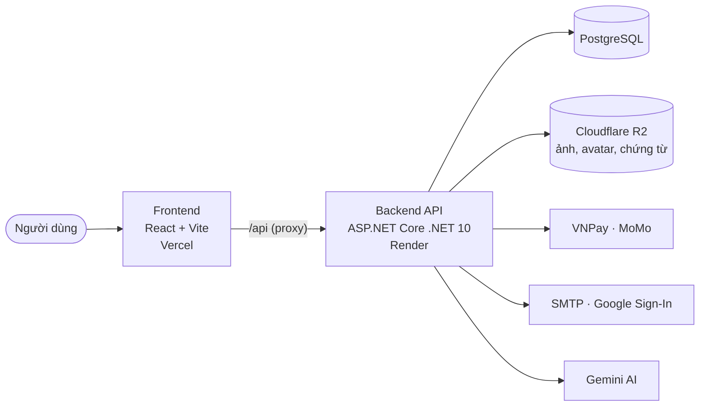

<div align="center">

# 🏟️ Olympic Sports Arena — Sports Center Management System

**Nền tảng quản lý trung tâm thể thao toàn diện: từ website giới thiệu đến vận hành hội viên, lớp học, thanh toán và báo cáo.**

<p>
  
  
  
  
  
  
  
</p>

Đồ án môn **SWP391** · Lớp **SE2039** · Nhóm **G06**

[Tổng quan](#-tổng-quan) ·
[Chức năng](#-chức-năng-theo-vai-trò) ·
[Kiến trúc](#-kiến-trúc) ·
[Bắt đầu](#-bắt-đầu-nhanh) ·
[Triển khai](#-triển-khai) ·
[Kiểm thử](#-kiểm-thử) ·
[Tài liệu](#-tài-liệu)

</div>

---

## 📌 Tổng quan

**SCMS** số hóa toàn bộ hoạt động của một trung tâm thể thao đa bộ môn:

- **Website công khai** giới thiệu trung tâm, bộ môn, cơ sở vật chất và sơ đồ khu vực tập luyện — nội dung do quản lý tự biên tập.
- **Cổng làm việc theo vai trò** cho hội viên, huấn luyện viên, lễ tân, quản lý và quản trị viên, phân quyền chi tiết theo từng trung tâm.
- **Thanh toán online** qua VNPay và MoMo, thanh toán tại quầy bằng tiền mặt/POS, hóa đơn và hoàn tiền có chứng từ.
- **Trợ lý AI** tư vấn cho hội viên và gợi ý giáo án cho huấn luyện viên, chỉ dựa trên dữ liệu thật của trung tâm.

## ✨ Chức năng theo vai trò

| Vai trò | Chức năng chính |
|---|---|
| 👤 **Khách** | Xem trang chủ, bộ môn, cơ sở vật chất, sơ đồ khu vực; đăng ký tài khoản (xác thực OTP email) hoặc đăng nhập Google |
| 🏃 **Hội viên** | Mua gói tập online, đăng ký môn và lớp, đặt/hủy ca tập, check-in, theo dõi tiến độ, yêu cầu hoàn tiền, gửi hỗ trợ, trò chuyện với trợ lý AI |
| 🧑‍🏫 **Huấn luyện viên** | Lịch dạy, điểm danh, danh sách học viên, giáo án và kết quả tập, gợi ý giáo án bằng AI, đơn nghỉ/đổi ca |
| 🛎️ **Lễ tân** | Tra cứu và tạo hội viên tại quầy, bán gói (tiền mặt/POS), đặt chỗ hộ, quản lý hóa đơn, tiếp nhận yêu cầu hỗ trợ |
| 📊 **Quản lý** | Hội viên, nhân sự, gói tập, lớp/bộ môn/phòng, phân công HLV, duyệt đơn nghỉ, hóa đơn & hoàn tiền, báo cáo doanh thu, nội dung trang chủ |
| 🛡️ **Quản trị viên** | Quản lý cơ sở và tài khoản quản lý, ma trận phân quyền, báo cáo toàn hệ thống, nhật ký kiểm toán |

## 🏗️ Kiến trúc



| Tầng | Công nghệ | Ghi chú |
|---|---|---|
| Frontend | React 18, Vite 5, Tailwind CSS | Kiến trúc Feature-Sliced Design: `app` · `pages` · `widgets` · `features` · `entities` · `shared` |
| Backend | ASP.NET Core Web API (.NET 10) | 3 lớp `API` · `BLL` · `DAL`; JWT; Swagger; EF Core + Npgsql, Dapper cho báo cáo |
| Dữ liệu | PostgreSQL, Cloudflare R2 | Migration EF Core tự áp dụng khi khởi động |
| Tích hợp | VNPay, MoMo, MailKit (SMTP), Google Sign-In, Gemini | Thiếu cấu hình thì API báo lỗi rõ ràng, không trả dữ liệu giả |
| Hạ tầng | Docker Compose, Render, Vercel | Local chạy toàn bộ bằng một lệnh |

<details>
<summary><b>Cấu trúc thư mục</b></summary>

```text
.
├── Backend/
│   ├── SportsCenterManagement.API/   # Controllers, xác thực & phân quyền, R2, email, cổng thanh toán
│   ├── SportsCenterManagement.BLL/   # Nghiệp vụ (services), DTO, quy tắc kiểm tra
│   ├── SportsCenterManagement.DAL/   # Entity, DbContext, migration PostgreSQL
│   ├── verification/                 # Chương trình kiểm tra logic (audit)
│   └── postman/                      # Bộ request mẫu
├── Frontend/
│   ├── src/                          # Mã nguồn React (Feature-Sliced Design)
│   └── tests/                        # Kiểm thử Node và kiểm thử trình duyệt Chrome
├── docker/                           # Compose, Dockerfile, cấu hình nginx
└── docs/                             # Triển khai, nội dung trang chủ, ghi chú phát hành
```

</details>

## 🚀 Bắt đầu nhanh

### Yêu cầu

- [Docker Desktop](https://www.docker.com/products/docker-desktop/) (khuyên dùng), **hoặc**
- .NET SDK 10, Node.js 20+ và PostgreSQL 16 nếu chạy không dùng Docker

### Chạy bằng Docker

```powershell
Copy-Item docker/.env.example docker/.env   # lần đầu, rồi điền giá trị thật
docker compose --env-file docker/.env -f docker/compose.yml up -d --build
```

| Dịch vụ | Địa chỉ |
|---|---|
| Website | http://localhost:3004 |
| API health | http://localhost:3004/api/health |

Dừng hệ thống (giữ dữ liệu): `docker compose --env-file docker/.env -f docker/compose.yml down`. Chi tiết: [docker/README.md](./docker/README.md).

<details>
<summary><b>Chạy không dùng Docker</b></summary>

1. Chuẩn bị PostgreSQL và cấu hình backend theo [Backend/README.md](./Backend/README.md) — cần `ConnectionStrings:SportsCenter` và `Jwt:Key` (ít nhất 32 byte).
2. Chạy API:
   ```powershell
   dotnet run --project Backend/SportsCenterManagement.API   # http://localhost:5000
   ```
3. Sao chép `Frontend/.env.example` thành `Frontend/.env.local`, đặt `VITE_SPORTS_CENTER_ID` bằng ID trung tâm trong database.
4. Chạy giao diện (Vite proxy `/api` tới cổng 5000):
   ```powershell
   cd Frontend
   npm ci
   npm run dev
   ```

</details>

### ⚙️ Cấu hình

Giá trị bí mật đặt trong `docker/.env` (local) hoặc Environment của Render — **không đưa lên GitHub**.

| Nhóm | Biến (Docker) | Bắt buộc |
|---|---|---|
| Database | `POSTGRES_PASSWORD` | ✅ |
| Xác thực | `JWT_KEY`, `ADMIN_USERNAME`, `ADMIN_EMAIL`, `ADMIN_PASSWORD` | ✅ |
| Trung tâm | `VITE_SPORTS_CENTER_ID` | ✅ |
| Lưu trữ ảnh | `R2_SERVICE_URL`, `R2_ACCESS_KEY`, `R2_SECRET_KEY`, `R2_BUCKET_NAME`, `R2_PUBLIC_DOMAIN` | Cho upload ảnh |
| Email | `EMAIL_SMTP_*` | Cho OTP và đặt lại mật khẩu |
| Đăng nhập Google | `GOOGLE_CLIENT_ID` | Tùy chọn |
| AI | `AI_API_KEY` | Cho trợ lý AI |
| Thanh toán | `VNPAY_*`, `MOMO_*` | Cho thanh toán online |

## ☁️ Triển khai

- **Backend + PostgreSQL:** Render — [docs/Deploy.md](./docs/Deploy.md)
- **Frontend:** Vercel, chuyển tiếp `/api` sang Render — [docs/VERCEL_DEPLOYMENT.md](./docs/VERCEL_DEPLOYMENT.md)
- **Nhánh phát hành:** mỗi đợt phát hành một nhánh `deploy/scms-v1.x`; `main` luôn là bản mới nhất. Render và Vercel deploy theo nhánh được chọn; nhánh trước dùng để quay lại khi cần.
- **Thay đổi từng phiên bản:** [docs/RELEASES.md](./docs/RELEASES.md)

## 🔐 Bảo mật & thời gian

- Đăng nhập bằng email, số điện thoại hoặc Google; mật khẩu băm BCrypt, có chính sách độ mạnh.
- JWT lưu trong **cookie HttpOnly**; mỗi tab có mã phiên riêng nên các tab dùng được tài khoản khác nhau mà không lộ token cho JavaScript.
- Phân quyền kiểm tra ở backend theo vai trò **và** theo trung tâm; thao tác thanh toán dùng `Idempotency-Key`.
- Hệ thống chạy theo giờ Việt Nam (`Asia/Ho_Chi_Minh`): database lưu UTC, ngày nghiệp vụ giữ nguyên ngày Việt Nam dù thiết bị đặt múi giờ khác.

## 🧪 Kiểm thử

| Phạm vi | Lệnh |
|---|---|
| Frontend build | `npm run build` *(trong `Frontend/`)* |
| Frontend unit & regression | `npm test` *(trong `Frontend/`)* |
| Trình duyệt Chrome | `npm run test:landing:browser` · `test:manager:browser` · `test:security:browser` *(trong `Frontend/`)* |
| Backend build | `dotnet build SportsCenterManagement.API/SportsCenterManagement.API.csproj` *(trong `Backend/`)* |
| Logic backend | `dotnet run --project Backend/verification/ReportLogicAudit` — tương tự `LandingSportDescriptionAudit`, `TimezoneAudit`, `CoachBusinessAudit`, `AiSafetyAudit` (không cần database); `PostgresMergeAudit` cần PostgreSQL local |
| Dữ liệu trên server | `dotnet run --project Backend/verification/AvatarRenderAudit` — kiểm tra **chỉ đọc** avatar và chứng từ hoàn tiền (đặt `SCMS_AUDIT_DB`, tùy chọn `SCMS_AUDIT_R2_PUBLIC_DOMAIN`) |

## 🌿 Quy trình phát triển

1. Tạo nhánh mới từ `main` cho đợt phát hành tiếp theo, ví dụ `deploy/scms-v1.5`.
2. Chạy kiểm thử frontend và build backend trước khi commit; chạy thử bằng Docker local.
3. Đẩy nhánh lên repo, deploy thử, rồi cập nhật `main` khi bản phát hành ổn định.
4. Ghi lại thay đổi vào [docs/RELEASES.md](./docs/RELEASES.md).

## 📚 Tài liệu

| Tài liệu | Nội dung |
|---|---|
| [docs/PROJECT_SUMMARY.md](./docs/PROJECT_SUMMARY.md) | Tổng quan nghiệp vụ dự án |
| [Backend/README.md](./Backend/README.md) | Cấu hình và chạy backend |
| [Backend/docs/requirements/api-jwt-integration.md](./Backend/docs/requirements/api-jwt-integration.md) | Tích hợp API và JWT |
| [docs/HOME_CONTENT_MEDIA.md](./docs/HOME_CONTENT_MEDIA.md) | Nội dung trang chủ và media |
| [Frontend/docs/tab-session-fix.md](./Frontend/docs/tab-session-fix.md) | Cơ chế phiên theo tab |
| [docs/RELEASES.md](./docs/RELEASES.md) | Ghi chú phát hành |

## 📄 Giấy phép

Phát hành theo giấy phép [MIT](./LICENSE).
